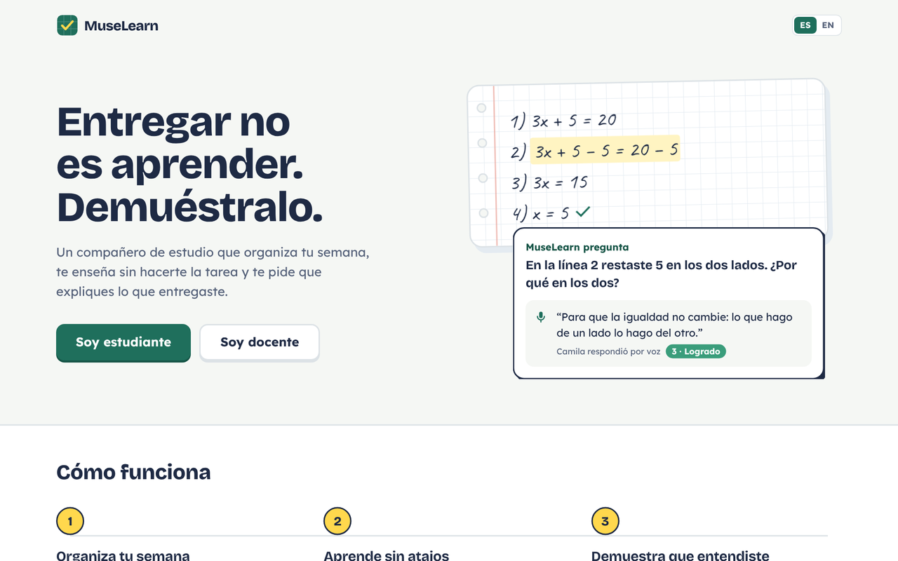
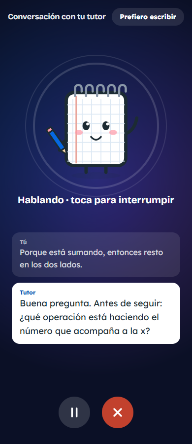
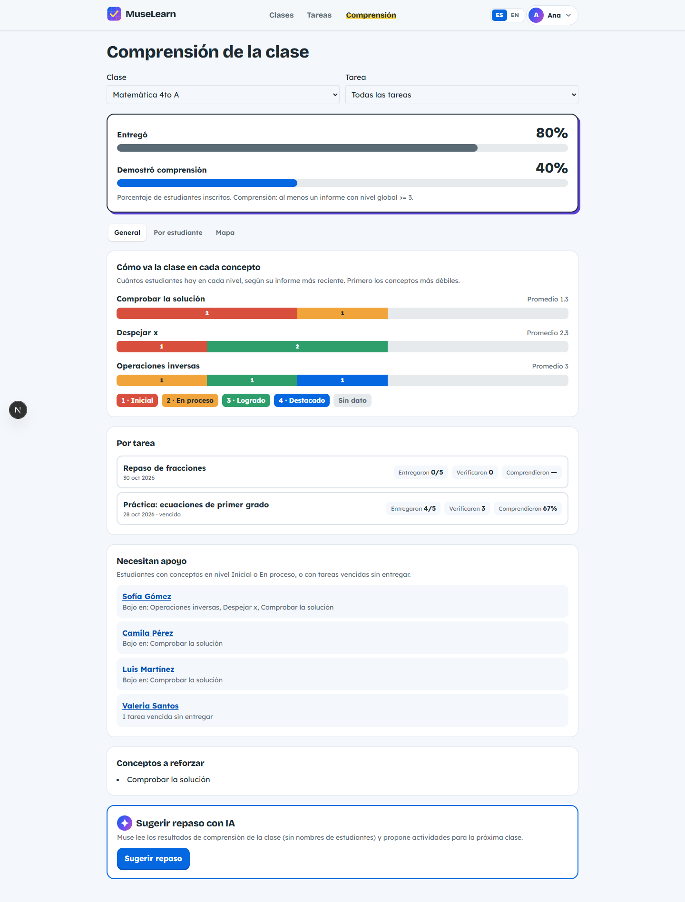

# MuseLearn

**An AI study companion that plans each student's week, tutors without doing the homework, and checks that the student really understood.**

**Live demo:** https://muselearn-five.vercel.app · demo accounts are listed in [`supabase/seed-auth.ts`](supabase/seed-auth.ts) (fictional data only).

Built for the **Meta AI Developer Hackathon 2026** — Indie track, theme *Build for Your World*.

> *Español:* MuseLearn es una plataforma para docentes y estudiantes de secundaria. La interfaz está en español e inglés.



---

## Why

I teach technology at a public secondary school in the Dominican Republic. My students juggle many subjects, and AI chatbots now make it easy to hand in work they don't understand. Teachers find out too late — at the exam.

MuseLearn keeps the classroom flow teachers already know (classes, tasks, submissions) and adds an agent that works **for learning, not around it**.

## What it does

| | For the student | For the teacher |
|---|---|---|
| **1. Plan** | Each new task is analyzed (difficulty, minutes, priority, concepts) and the week is re-planned around the student's real schedule. *Today* shows what to do now. | Sees which tasks will be hard for whom before the due date. |
| **2. Tutor** | A Socratic tutor answers with questions and hints at the help level the teacher chose — it **never solves the task**. | Chooses the help level per task: hints, worked examples, or explanation. |
| **3. Verify** | After submitting — including **photos of the handwritten notebook** — the student answers 3–5 short questions about *their own* work, by **voice** or text. | Gets a comprehension report per student and concept, not just "submitted". |
| **4. Improve** | A personalized practice route of 2–6 steps for the weak concepts. | A **heatmap** (student × concept) with the concepts the class needs to review. |
| **5. Teach** | Reads the teacher's comment on each submission. | **AI for the teacher:** drafts a full task from a topic, suggests a review plan from the heatmap (anonymous, aggregated data only), and drafts feedback for each submission that the teacher edits before sending. |

### Screens

**Student (390 px):** tap the companion to talk, provide evidence for a Classroom assignment, explain the work, and receive a practice path.



**Teacher (1440 px):** create a task with AI, compare submission with demonstrated understanding, move from General to each student, and review AI-drafted feedback.



| Scene | Desktop | Phone |
|---|---|---|
| Create with AI | [1440 px](docs/capturas/demo-01-crear-ia-1440.png) | [390 px](docs/capturas/demo-01-crear-ia-390.png) |
| Today | [1440 px](docs/capturas/demo-02-hoy-1440.png) | [390 px](docs/capturas/demo-02-hoy-390.png) |
| Classroom evidence | [1440 px](docs/capturas/demo-05-classroom-evidencia-1440.png) | [390 px](docs/capturas/demo-05-classroom-evidencia-390.png) |
| Explanation | [1440 px](docs/capturas/demo-06-verificacion-1440.png) | [390 px](docs/capturas/demo-06-verificacion-390.png) |
| Report and practice | [1440 px](docs/capturas/demo-07-informe-1440.png) | [390 px](docs/capturas/demo-07-informe-390.png) |
| Per student | [1440 px](docs/capturas/demo-09-estudiante-1440.png) | [390 px](docs/capturas/demo-09-estudiante-390.png) |
| Reviewed feedback draft | [1440 px](docs/capturas/demo-10-comentario-1440.png) | [390 px](docs/capturas/demo-10-comentario-390.png) |

*Captured October 29, 2026 with fictional data (`NEXT_PUBLIC_USAR_MOCKS=true`). Reports and AI replies are fixed mocks; voice input in the automated rehearsal is synthetic. Classroom submission is the student's confirmation, not a submission sent to Google. See the [2:55 script](.orquesta/DEMO.md) and [desktop/phone rehearsal](e2e/demo-guion.spec.ts).*

### Why it is not "another chatbot"
- The agent acts on its own when something happens (new task, submission, missed study block) instead of waiting for a prompt.
- Its output is a **plan, a verification and a report**, not a chat transcript.
- It reads the student's real work — including handwriting from notebook photos — and asks about specific steps ("in line 3 you wrote…").

## Built on Meta models

| Job | Model | Where |
|---|---|---|
| Socratic tutor, comprehension questions, reading notebook photos, report and route | **Muse Spark 1.3** | Meta Model API |
| Voice answers (speech to text, Spanish/English) | **Muse Voice Transcribe 1.0** | Meta Model API |
| Batch task analysis and weekly planning | **Muse Spark Open** (open weights) | Baseten · Modal |
| Fallback | **Muse Glimmer 30B** | NVIDIA |

Every call goes through one client (`src/lib/ia/cliente.ts`) that picks the provider per job, validates the JSON output against Zod schemas, retries once and falls back to the next provider.

## Stack

- **Next.js 16** (App Router, React 19) · TypeScript · Tailwind CSS 4 · `next-intl` (es/en)
- **Supabase**: Postgres with Row Level Security, Auth, Storage (private buckets for attachments and audio)
- Vitest and Playwright for tests
- Mobile-first: everything works at 380 px wide, so students can use their phones

## Status

Work in progress during the hackathon (Oct 27 – Nov 4, 2026).

- [x] Teacher and student accounts, roles, classes with a 6-character join code
- [x] Tasks with attachments; submissions with text, files and notebook photos (compressed on the phone)
- [x] AI task analysis and weekly planner with automatic re-planning
- [x] Socratic tutor (streaming, respects the teacher's help level)
- [x] Comprehension check by voice or text, with evidence quoted from the student's own answers
- [x] Student dashboard (*Today*, *Week*, task page)
- [x] Understanding report, practice route and teacher heatmap ("submitted" vs. "understood")
- [x] "Add to my week": the practice route becomes study blocks (one step per day) that re-planning keeps
- [x] Daily AI usage limits per account, so a public demo can't drain the model credits
- [x] AI for the teacher: create a task with AI, review suggestions from the heatmap, feedback drafts
- [x] Google Classroom import (test mode): bring a course and its students into MuseLearn
- [x] Sign in with Google and password recovery by email
- [x] Tasks can be done in MuseLearn, in the notebook, on Google Classroom or another platform (Moodle, Teams…): the student uploads evidence and still does the comprehension check
- [x] Classroom import brings the course's upcoming tasks too, and students who join late get their pending tasks planned
- [x] Privacy policy and Terms of use (Dominican Law 172-13), required acceptance, data download and account deletion
- [x] Teacher comprehension panel with overview (by concept, by task, who needs support), per-student profile and heatmap
- [ ] Notebook-photo reading tested with real handwriting
- [x] Public deployment (Vercel)
- [ ] Demo video

## Run it locally

- `npm run rls` — tests RLS against an isolated local PostgreSQL cluster (requires PostgreSQL binaries in PATH or `RLS_PG_BIN`); see [instructions](supabase/pruebas-rls/README.md).

Requirements: Node.js 22+, a Supabase project and a Meta Model API key.

```bash
npm install
cp .env.example .env.local      # fill in the keys (never committed)
npm run dev                     # http://localhost:3000
```

- **No keys yet?** Keep `NEXT_PUBLIC_USAR_MOCKS=true` in `.env.local` and the UI runs on sample data.
- `npm run prueba:ia` — checks that each AI provider in `.env.local` answers.
- `npm run seed:auth` — creates fictional demo users and a demo class; then run `supabase/seed-demo.sql` in the Supabase SQL Editor for demo tasks, submissions and reports.
- `npm run e2e` — end-to-end tests of the demo flow (desktop and phone) with sample data.
- Database schema and RLS policies: `supabase/migrations/`.
- `npm run lint`, `npm run typecheck`, `npm test`, `npm run build`.

## Demo accounts and data

All names and work are invented. The shared dataset contains one teacher,
twelve students and two classes: **Matemática 4to A** (`MAT4KQ`) and
**Tecnología 4to B** (`TEC4ZR`). Every student is enrolled in both classes.

Use `docente@muselearn.demo` for the teacher and `camila@muselearn.demo` for
the student in the script. Other student accounts are `luis`, `sofia`, `diego`,
`valeria`, `yandel`, `alondra`, `dariel`, `nayeli`, `elian`, `kiara` and `jadiel`,
all at `@muselearn.demo`. The full roster is in
[`supabase/demo/cuentas.json`](supabase/demo/cuentas.json).

To load a **dedicated demo Supabase project** (the integrator runs these steps):

1. Apply the existing migrations through `0009_calificaciones.sql`.
2. Set that project's `NEXT_PUBLIC_SUPABASE_URL` and `SUPABASE_SERVICE_ROLE_KEY`
   in `.env.local`. Set `DEMO_CONTRASENA` there to a private password of at least
   12 characters. There is no default password and the seed never prints it.
3. Run `npm run seed:auth`, then execute `supabase/seed-demo.sql` in the same
   project's SQL Editor. Never run either seed against production.
4. Sign in with the accounts above and the password from `.env.local`.
   Accept the terms on first sign-in. Use `NEXT_PUBLIC_USAR_MOCKS=false` for this mode.

Both seeds can be repeated. IDs are fixed; occupied IDs/emails belonging to other
accounts cause an error. The SQL transaction resets only the specified fictional
submissions and their evidence; other accounts and classes remain untouched.
Dates follow the current week in `America/Santo_Domingo`: overdue work, current
week and next week. Camila has two study blocks each day and plans for both weeks.
Mathematics includes levels 1–4, four students needing support, teacher comments,
optional grades and Elian's returned submission for correction.

Without keys, set `NEXT_PUBLIC_USAR_MOCKS=true`. The roster, tasks, overview,
Camila's plan and initial grades use the same dataset. **Current integration
limitation:** the shared API mock still returns Camila's report/questions for
other submissions and starts teacher comments empty. T15 records the required
client update in its integration requests; database demo data is complete.

After editing mock data, run `node supabase/demo/generar.mjs` to regenerate the
SQL and validation fixtures, then `npm run lint`, `npm run typecheck`, `npm test`.
For the isolated PostgreSQL repeatability check, see
[`supabase/demo/PRUEBAS.md`](supabase/demo/PRUEBAS.md).

## Privacy

- Only fictional data in this repository and in the seeds.
- Each student sees only their own work; teachers see only their own classes (enforced by RLS in the database, not just in the UI).
- Verification audio is deleted after transcription.
- Users can download all their data and delete their account from Settings → Privacy and data.
- Student data is never sent to Meta's *Contributor* tier.

## How it was built

All product code was written during the hackathon build period, starting **October 27, 2026**.

I designed the architecture and the contracts (types, API and database schema) first, then built the pieces in parallel with AI coding agents (Claude Code, Codex, OpenCode), each working on its own branch with strict file ownership, and integrated and reviewed every piece myself. The design documents, task sheets and the prompts used by the app's own agents are in [`.orquesta/`](.orquesta/).

## Author

**José Enrique Ulloa** — technology teacher, Dominican Republic.
