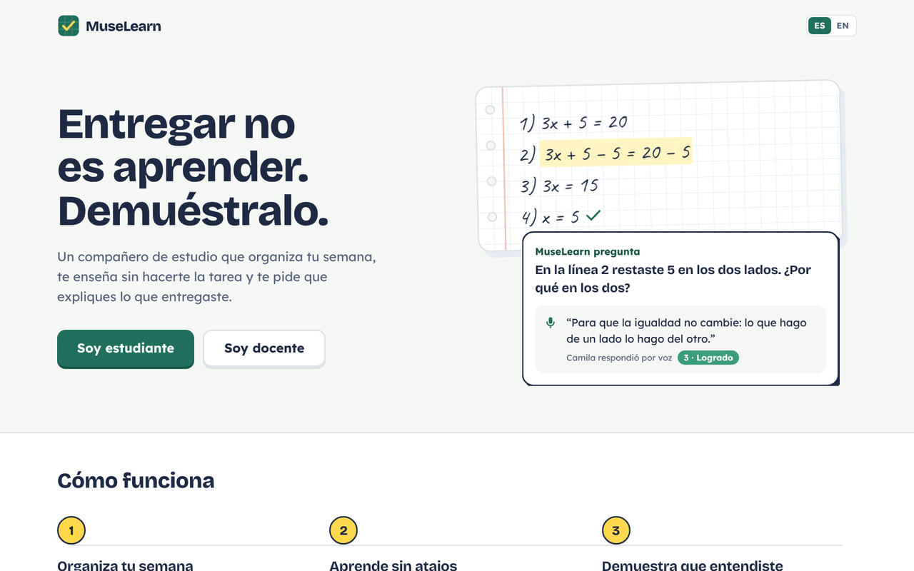
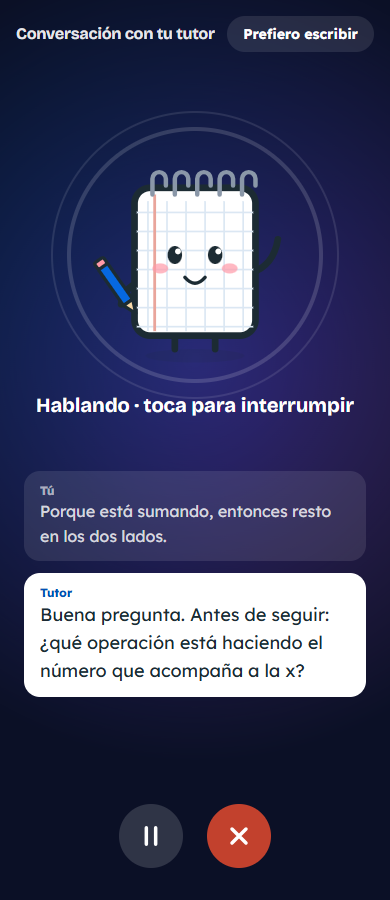
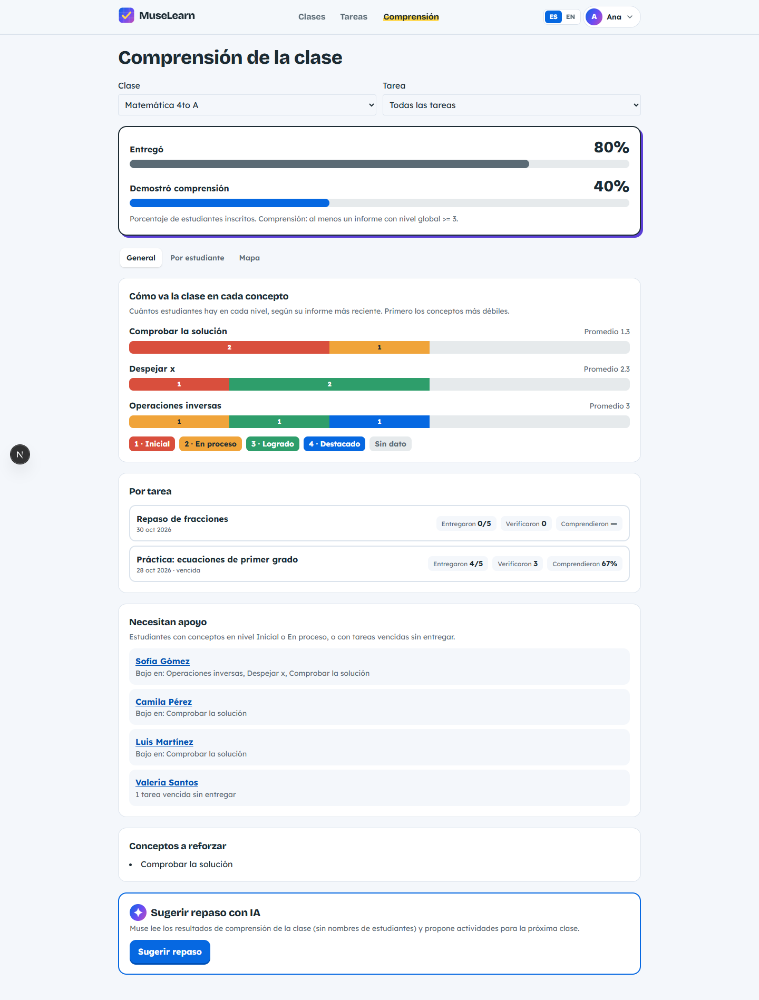
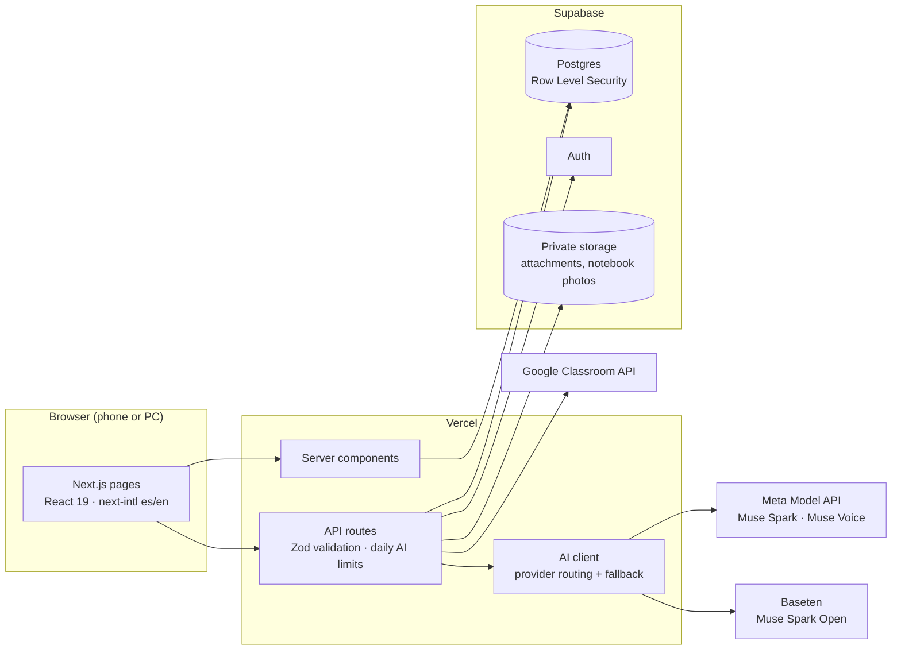

# MuseLearn

**An AI study companion for secondary school: it plans each student's week, tutors without doing the homework, and checks that the student really understood what they handed in.**

[](https://muselearn-five.vercel.app)


[](LICENSE)

**[Live demo](https://muselearn-five.vercel.app)** · **[How it works](https://muselearn-five.vercel.app/en/como-funciona)** ([español](https://muselearn-five.vercel.app/es/como-funciona)) · **[Documentation](docs/)**

Built for the **Meta AI Developer Hackathon 2026**, Indie track, theme *Build for Your World*.

> *Español:* MuseLearn es una plataforma para docentes y estudiantes de secundaria. La interfaz está en español e inglés.



## Contents

- [The problem](#the-problem)
- [What it does](#what-it-does)
- [Screens](#screens)
- [Built on Meta models](#built-on-meta-models)
- [Architecture](#architecture)
- [Run it locally](#run-it-locally)
- [Demo data](#demo-data)
- [Testing](#testing)
- [Project structure](#project-structure)
- [Privacy and security](#privacy-and-security) ([security policy](SECURITY.md))
- [How it was built](#how-it-was-built)
- [License](#license)

## The problem

I teach technology at a public secondary school in the Dominican Republic. My students juggle many subjects, and AI chatbots now make it easy to hand in work they don't understand. Teachers find out too late, at the exam.

MuseLearn keeps the classroom flow teachers already know (classes, tasks, submissions) and adds an agent that works **for learning, not around it**: every submission ends with the student explaining their own work, and the teacher sees *understood*, not just *submitted*.

## What it does

| | For the student | For the teacher |
|---|---|---|
| **Plan** | Each new task is analyzed (difficulty, minutes, priority, concepts) and the week is re-planned around the student's real schedule. *Today* shows what to do now; *Classes* shows every subject, its teacher and its tasks. | Sees which tasks will be hard for whom before the due date. Creates a full task from a topic with AI. |
| **Tutor** | A Socratic tutor answers with questions and hints at the help level the teacher chose. It **never solves the task**. Text or voice conversation. | Chooses the help level per task: hints, worked examples, or explanation. |
| **Verify** | After submitting, including **photos of the handwritten notebook**, the student answers 3–5 short questions about *their own* work, by **voice** (with a live waveform) or text. | Gets a notice when a student submits, and a comprehension report per student and concept. |
| **Review** | Reads the teacher's comment, grade or request to correct. | Reviews submissions one after another, Classroom-style, with photos in a built-in viewer. **Review with AI** checks the work against the task's instructions and suggests a grade and comments; **Review all with AI** prepares every submission in one go. The teacher decides what is saved and sent. |
| **Improve** | A personalized practice route of 2–6 steps for the weak concepts, which can be added to the week. A *Finish* button closes the task. | A class overview, a per-student profile (history, grades, understanding by concept) and a **heatmap** (student × concept). AI suggests review activities and turns them into practice tasks. |

Also:

- **Works with the platforms schools already use:** a task can be done in MuseLearn, in the notebook, on Google Classroom or on another platform (Moodle, Teams…). Classroom import brings courses, students and upcoming tasks.
- **Feedback and exports:** optional grades, return for correction, teacher comments, and Excel-friendly CSV exports of submissions and comprehension.
- **Accounts:** email and password with recovery by email (Google sign-in is built and can be switched on), Spanish and English, light and dark themes.
- **Privacy built in:** required policy acceptance, per-user access enforced in the database, data download and account deletion. Voice audio is not stored.

## Screens

**Student (390 px):** talk to the companion, provide evidence for a Classroom assignment, explain the work and receive a practice path.



**Teacher (1440 px):** compare submission with demonstrated understanding, move from the class overview to each student, and review AI-drafted feedback.



| Scene | Desktop | Phone |
|---|---|---|
| Create a task with AI | [1440 px](docs/capturas/demo-01-crear-ia-1440.png) | [390 px](docs/capturas/demo-01-crear-ia-390.png) |
| Today | [1440 px](docs/capturas/demo-02-hoy-1440.png) | [390 px](docs/capturas/demo-02-hoy-390.png) |
| Socratic tutor | [1440 px](docs/capturas/demo-04-tutor-1440.png) | [390 px](docs/capturas/demo-04-tutor-390.png) |
| Classroom evidence | [1440 px](docs/capturas/demo-05-classroom-evidencia-1440.png) | [390 px](docs/capturas/demo-05-classroom-evidencia-390.png) |
| Explaining the work | [1440 px](docs/capturas/demo-06-verificacion-1440.png) | [390 px](docs/capturas/demo-06-verificacion-390.png) |
| Report and practice | [1440 px](docs/capturas/demo-07-informe-1440.png) | [390 px](docs/capturas/demo-07-informe-390.png) |
| Per student | [1440 px](docs/capturas/demo-09-estudiante-1440.png) | [390 px](docs/capturas/demo-09-estudiante-390.png) |
| Reviewed feedback draft | [1440 px](docs/capturas/demo-10-comentario-1440.png) | [390 px](docs/capturas/demo-10-comentario-390.png) |

*Captured with fictional data in mock mode (`NEXT_PUBLIC_USAR_MOCKS=true`): reports and AI replies are fixed samples and voice input is synthetic. The automated desktop/phone walkthrough is [`e2e/demo-guion.spec.ts`](e2e/demo-guion.spec.ts).*

### Why it is not "another chatbot"

- The agent acts when something happens (a new task, a submission, a missed study block) instead of waiting for a prompt.
- Its output is a **plan, a verification and a report**, not a chat transcript.
- It reads the student's real work, including handwriting from notebook photos, and asks about specific steps ("in line 3 you wrote…").

## Built on Meta models

| Job | Model | Provider |
|---|---|---|
| Socratic tutor, comprehension questions, report, practice route, AI for the teacher | **Muse Spark 1.3** | Meta Model API (fallback: Muse Spark Open) |
| Reading notebook photos, reviewing submissions with photos | **Muse Spark 1.3** (vision) | Meta Model API |
| Voice answers (speech to text, Spanish and English) | **Muse Voice Transcribe 1.0** | Meta Model API |
| Task analysis and weekly planning (batch) | **Muse Spark Open** (open weights) | Baseten (fallbacks: Meta Model API, NVIDIA) |

Every call goes through one client, [`src/lib/ia/cliente.ts`](src/lib/ia/cliente.ts), which picks the provider per job, validates the JSON output against Zod schemas, retries once and falls back to the next provider. Reading aloud uses the browser's own speech synthesis. Student data is never sent to Meta's *Contributor* tier.

## Architecture



- **Next.js 16** (App Router, React 19), TypeScript (strict), Tailwind CSS 4, `next-intl` (Spanish and English).
- **Supabase**: Postgres with Row Level Security on every table, Auth (email/password and Google), private storage for attachments.
- Every API input and every AI output is validated with the shared Zod contracts in [`src/types/contratos.ts`](src/types/contratos.ts).
- Mobile first: everything works at 360 px wide, so students can use their phones.

Full design documentation (vision, requirements, use cases, architecture, diagrams, data model, API, security, testing, operations and user guide) is in **[`docs/`](docs/)**.

## Run it locally

Requirements: Node.js 22+. For real data, a Supabase project and a Meta Model API key.

```bash
npm install
cp .env.example .env.local      # fill in the keys (never committed)
npm run dev                     # http://localhost:3000
```

- **No keys yet?** Keep `NEXT_PUBLIC_USAR_MOCKS=true` in `.env.local` and the whole UI runs on sample data.
- Database: apply the migrations in [`supabase/migrations/`](supabase/migrations/) in order (`0001` … `0015`).
- `npm run prueba:ia` checks that each AI provider configured in `.env.local` answers.

### Monitoring AI usage

Every model call is recorded in the `uso_ia` table (provider, job, model, tokens, success or failure; never prompts, answers or student text). Set `ADMIN_CORREOS` (comma-separated emails) to enable the private page `/docente/uso-ia`, which shows calls, failures, tokens and estimated cost per provider. Prices per million tokens come from `PRECIO_META_ENTRADA`, `PRECIO_META_SALIDA`, `PRECIO_ABIERTO_ENTRADA`, `PRECIO_ABIERTO_SALIDA`, `PRECIO_NVIDIA_ENTRADA` and `PRECIO_NVIDIA_SALIDA`; without them only tokens are shown. `CREDITO_ABIERTO_USD` (default 100) sets the open-weight credit shown on the page. These are estimates made by MuseLearn, not billing.

```sql
-- Backup query in the Supabase SQL editor
select proveedor, modelo, count(*) llamadas, count(*) filter (where not ok) fallidas,
       sum(tokens_entrada) entrada, sum(tokens_salida) salida
from public.uso_ia group by proveedor, modelo order by proveedor, modelo;
```

## Demo data

All names and work are invented. The dataset has one teacher, twelve students and two classes, **Matemática 4to A** and **Tecnología 4to B**; every student is enrolled in both. Use `docente@muselearn.demo` for the teacher and `camila@muselearn.demo` for the student. The full roster is in [`supabase/demo/cuentas.json`](supabase/demo/cuentas.json).

To load it into a **dedicated** Supabase project:

1. Apply all migrations in order.
2. In `.env.local`, set that project's `NEXT_PUBLIC_SUPABASE_URL` and `SUPABASE_SERVICE_ROLE_KEY`, and `DEMO_CONTRASENA` to a private password of at least 12 characters. There is no default password and the seed never prints it.
3. Run `npm run seed:auth`, then execute [`supabase/seed-demo.sql`](supabase/seed-demo.sql) in that project's SQL Editor.
4. Sign in with the accounts above and accept the terms on first sign-in.

Both seeds can be repeated safely: IDs are fixed, only the fictional accounts are touched, and dates follow the current week. After editing mock data, `node supabase/demo/generar.mjs` regenerates the SQL ([details](supabase/demo/PRUEBAS.md)).

## Testing

| Suite | Command | What it covers |
|---|---|---|
| Unit | `npm test` | 260+ Vitest tests: contracts, AI client routing and fallback, prompts, planner, verification flow, permissions of each endpoint |
| End to end | `npm run e2e` | 170+ Playwright checks on desktop and phone viewports, in mock mode: the full demo flow, accessibility (axe), voice, review, exports |
| Database security | `npm run rls` | 214 checks of Row Level Security against an isolated local PostgreSQL ([how to run](supabase/pruebas-rls/README.md)) |
| Static | `npm run lint`, `npm run typecheck` | ESLint and strict TypeScript |

Run end-to-end tests with `NEXT_PUBLIC_USAR_MOCKS=true` so they never call a model or a real database.

## Project structure

```
src/
  app/[locale]/        pages for teachers, students, sign-in and legal pages (es/en)
  app/api/             API routes: classes, tasks, submissions, tutor, verification,
                       reports, teacher AI, voice, notices, Classroom, profile
  components/          UI by area (student, teacher, tasks, verification, reports, ui/)
  lib/ia/              AI client, prompts, analyzer, planner, tutor, verifier, teacher AI
  lib/db/              data access, limits, storage, notices (server only)
  lib/integraciones/   Google Classroom
  types/contratos.ts   shared Zod contracts for API and AI outputs
messages/{es,en}/      interface text
supabase/
  migrations/          schema and RLS policies
  demo/                fictional demo dataset and generator
  pruebas-rls/         database security tests
e2e/                   Playwright tests
docs/                  project documentation and screenshots
```

## Privacy and security

- Only fictional data in this repository and in the seeds.
- Each student sees only their own work and teachers see only their own classes. This is enforced by Row Level Security in the database, not just in the interface, and tested by `npm run rls`.
- API keys live only on the server; the browser never receives them.
- Uploaded files are private; teachers get short-lived signed links only for their own classes.
- Verification audio is transcribed in memory and is not stored.
- Daily AI limits per account protect the model credits of a public demo.
- Users can download all their data and delete their account from *Settings → Privacy and data*.
- Session cookies are HttpOnly, data-changing API requests from other sites are rejected, and security headers block framing. See [`SECURITY.md`](SECURITY.md) to report a problem.

## How it was built

All product code was written during the hackathon build period, starting **October 27, 2026**. Architecture notes, task sheets and draft prompts were prepared before the build started; the Git history records the implementation.

I designed the product, the architecture and the contracts (types, API and database schema) first. The pieces were then built in parallel by AI coding agents, each on its own branch with strict file ownership, following task sheets I wrote with them:

- **Claude Code** (Anthropic): architecture and contracts, the first modules, integration and review of every branch, database migrations and deployment.
- **Codex** (OpenAI): most of the features in the second half of the build, such as the tutor, verification and reports, grading, CSV export, voice, demo data, database security tests and the AI review of submissions.
- **OpenCode**: interface work such as notices, accessibility, mobile performance and the students' *Classes* section.

I directed the work, tested it with my own devices and approved every change before it was published. The original design notes, task sheets and agent prompts are preserved in the Git history, for example in [`.orquesta/` at commit 0edadd6](https://github.com/Josezx18/muselearn/tree/0edadd6/.orquesta).

## License

[MIT](LICENSE) © 2026 José Enrique Ulloa

## Author

**José Enrique Ulloa**, technology teacher, Dominican Republic · josejx18@gmail.com
