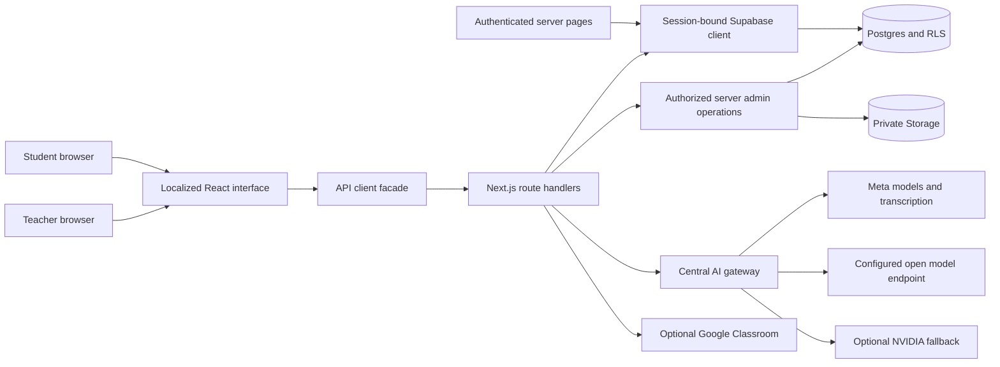
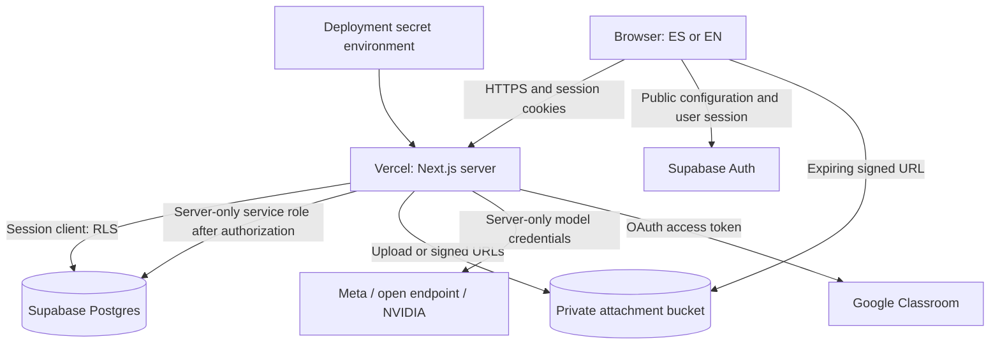
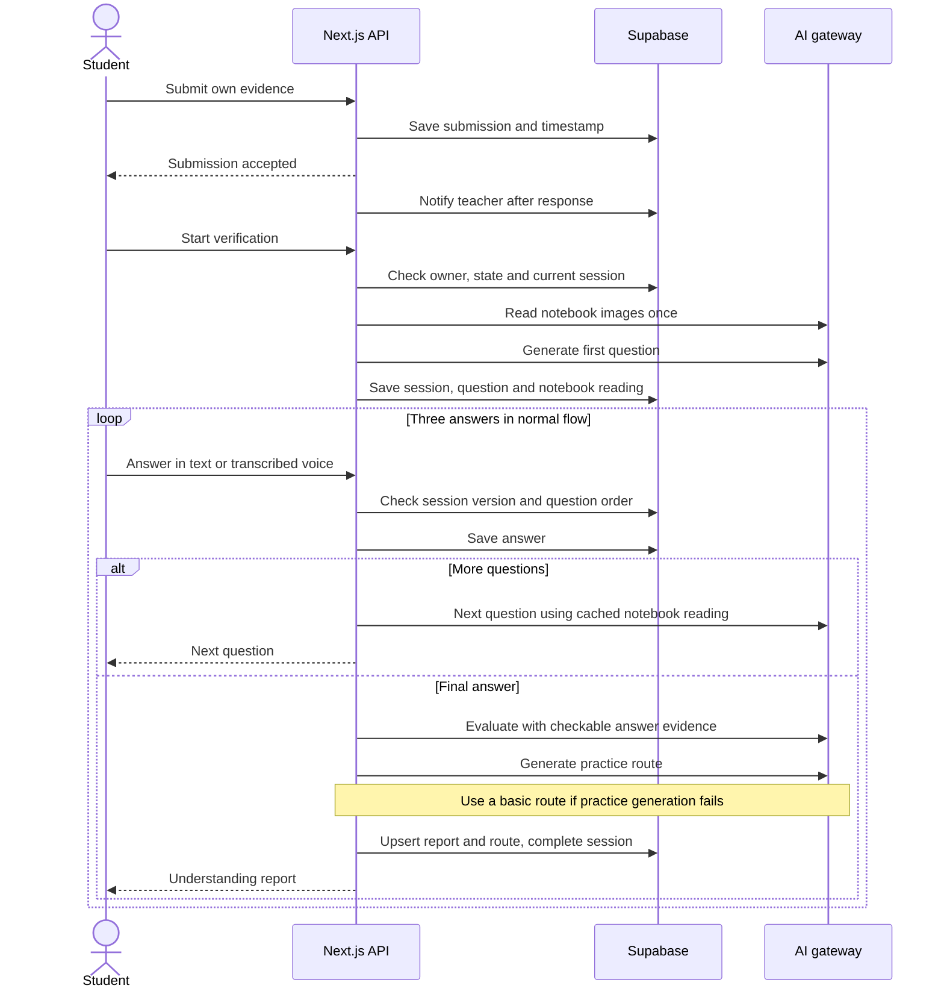
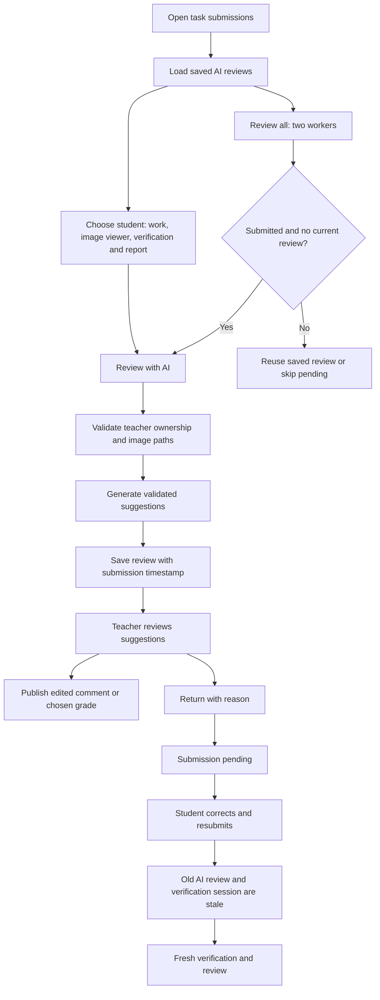
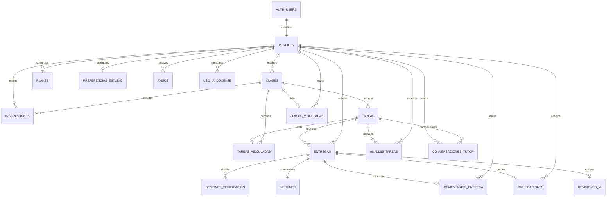

# System diagrams

GitHub renders these Mermaid blocks. Names represent runtime responsibilities and database relationships; they do not imply separate deployed microservices.

## Application architecture

## Deployment and trust boundaries

## Submission -> verification -> report

## Teacher review and correction

## Entity relationships

All application foreign keys above cascade on deletion. JSON payload structure and per-table policies are detailed in the [data model](07-data-model.md).
