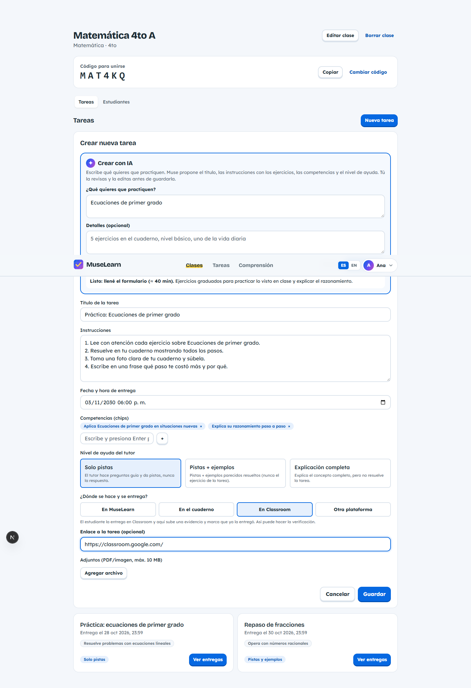
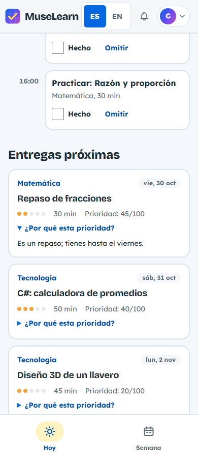
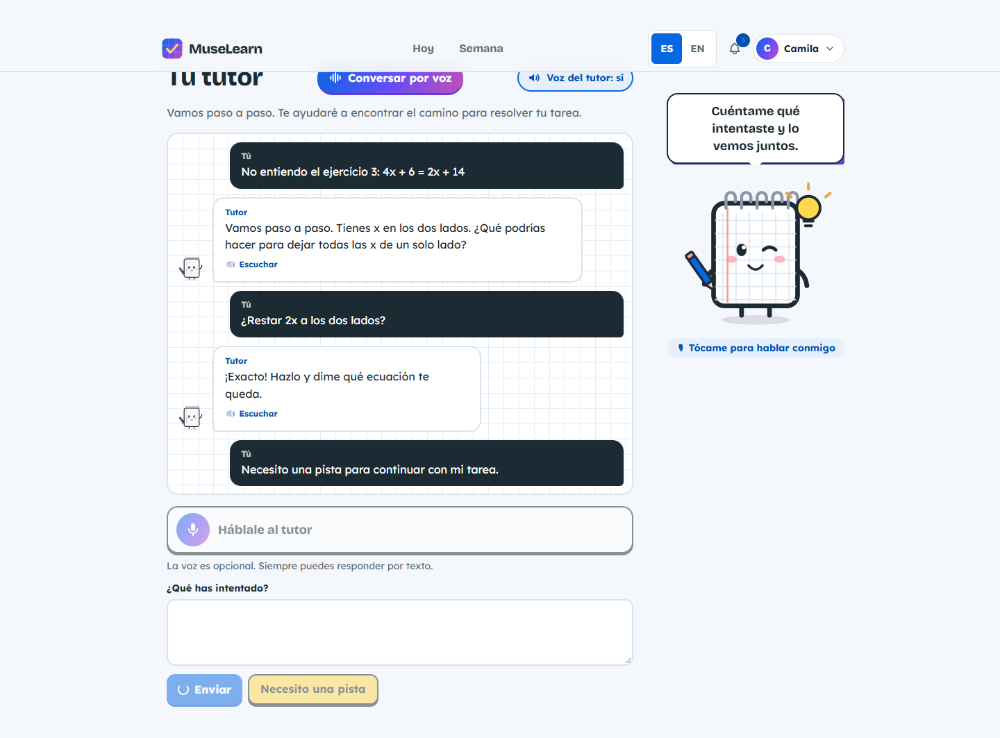
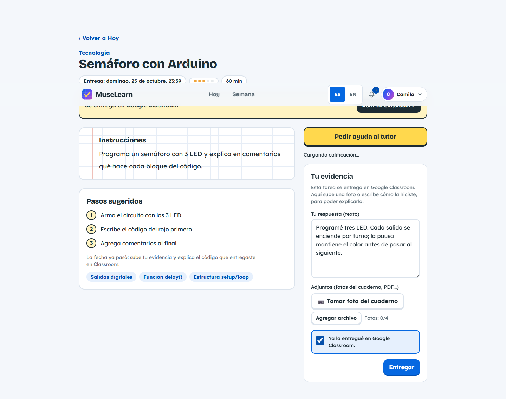
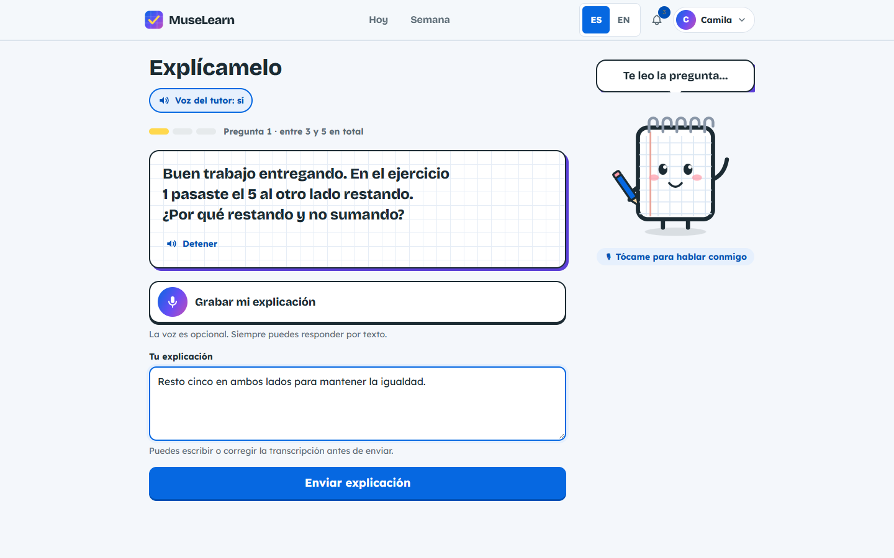
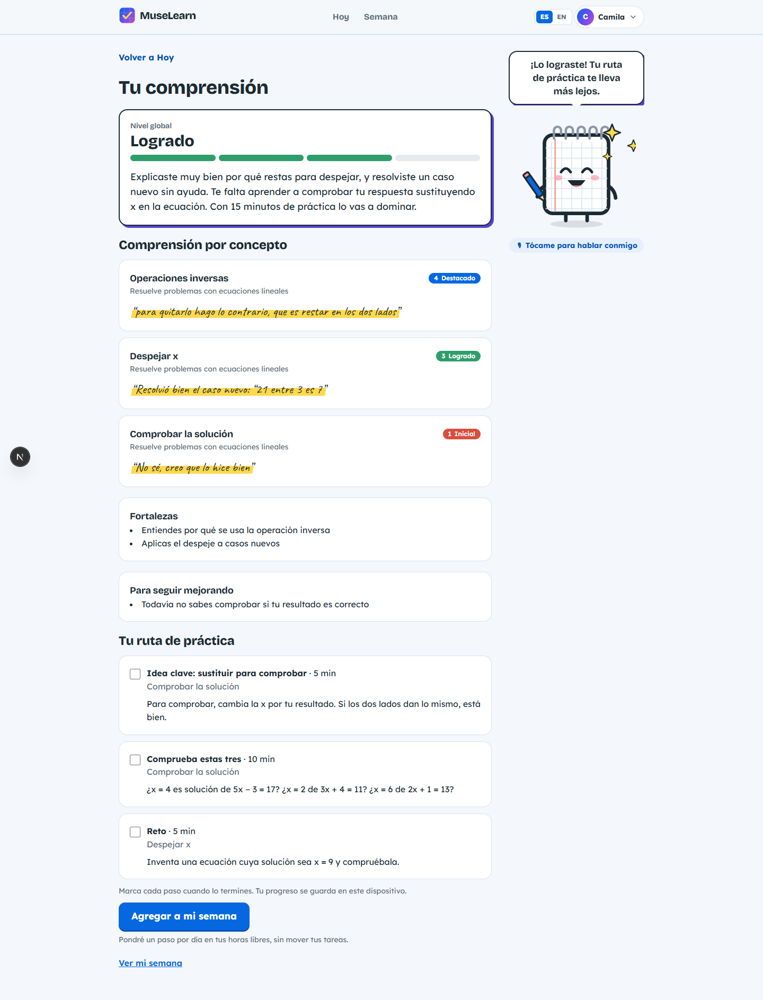
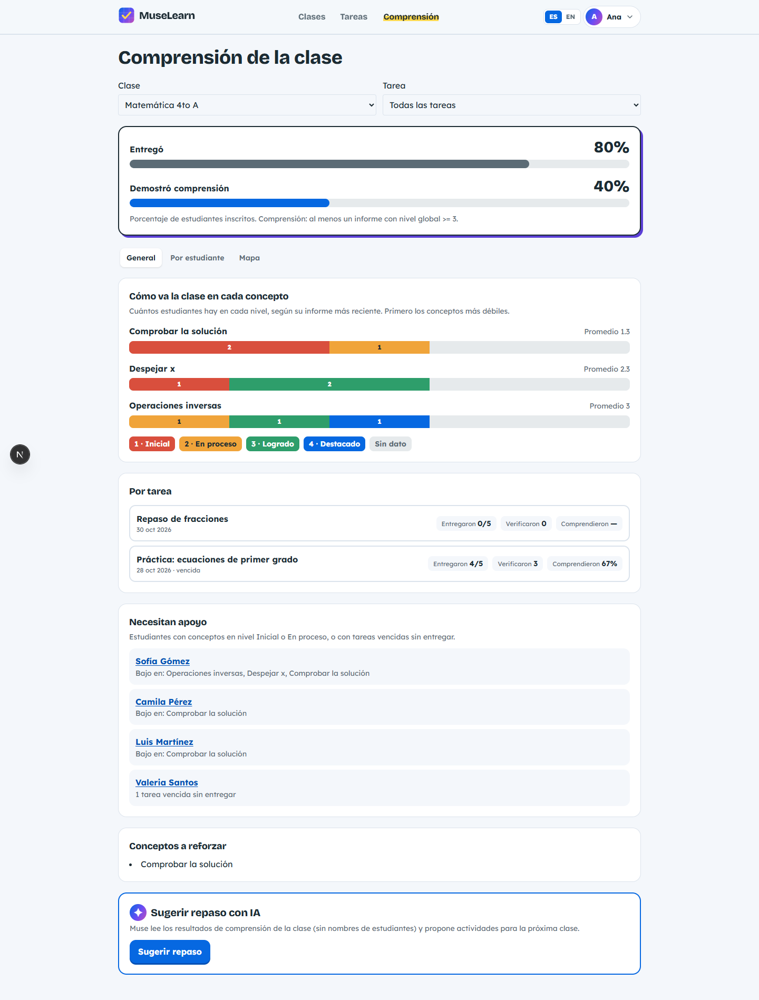

# User guide

MuseLearn is available in Spanish and English. The screenshots below use fictional demonstration accounts and simulated responses; they illustrate selected screens and can predate newer controls. No credentials are included here.

## Sign in and prepare your account

Choose Teacher or Student when creating an account. Sign in with email/password, or Continue with Google when the operator has enabled it. Use the recovery link on the login screen if you forget your password; follow the email to choose a new password. Accept the current Terms and Privacy documents when prompted. Your profile menu offers language, appearance and companion settings, account export and deletion.

## Teacher: create a class and task

Create a class with its name, subject and grade, then share the six-character enrollment code with students. Open the class to view enrollment and tasks. You can renew the invitation code or remove an enrollment; removing enrollment preserves submitted work.

Create a task manually or choose Create with AI. Give a topic and any constraints, review the proposed instructions/competencies and edit before saving. Choose a deadline and tutor help level:

| Help level | What the tutor may provide |
|---|---|
| Hints (`pistas`) | Guiding questions and hints |
| Examples (`ejemplos`) | Hints plus solved analogous examples, without solving this task |
| Explanation (`explicacion`) | Full concept explanation without completing the assigned exercise |

Select where students complete/deliver the work: MuseLearn, notebook, Classroom or another platform. Supply an external link when appropriate. Origin labels show AI-created tasks, AI review practice and Classroom imports; they describe where a task came from, independently of where students do it.

To import Classroom, open the integration screen, connect the authorized Google account, select a course and import. Review the reported new/existing/skipped tasks and permission notices. The connection can expire; reconnect if asked. Disconnect removes the app connection cookie. MuseLearn imports upcoming work and does not send student submissions back to Classroom.

## Student: join and organize

Join with the teacher's code. My classes lists your enrolled classes and teachers; open one to see its assignments and your delivery state. Today highlights upcoming work; Week shows scheduled study blocks and lets you move between weeks. Open a task to see instructions, estimated effort, priority explanation and suggested steps. Mark blocks done or skipped, or reorganize your week. Study preferences define available time and block length.

## Student: learn and submit evidence

Open the tutor from a task. Explain where you are stuck and answer its guiding questions. The teacher's help level controls the guidance. Voice mode offers speech playback and preferences; recording feedback includes a waveform in the current interface. If microphone permission or transcription fails, switch to editable text. Review transcribed words before sending them.

When ready, submit text, files or notebook photos. The photo form supports up to four images and compresses them; upload limits apply. Use clear, well-lit photos with the whole relevant working visible. For Classroom or another external platform, follow the task link and deliver there yourself, then confirm external delivery and add evidence in MuseLearn. That checkbox does not send your work to the other service.

## Student: explain and practice

After submitting, start verification. Answer three questions about your own work using text or voice. Notebook reading is reused within the session, so you do not need to upload the photos again for each question. Work cannot be replaced while it is being verified or after verification unless the teacher returns it.

After the final answer, read your report. Use Finish to close the completed flow and return to Today. The report shows an overall understanding level, concept evidence, strengths, areas to improve and a practice route. Levels are Initial (1), Developing (2), Achieved (3) and Outstanding (4). These describe understanding evidence and are separate from the teacher's optional 0-100 grade. Add practice to your week when offered; if some steps cannot fit, the interface reports that rather than inventing available time.

If evaluation fails, retry as offered; your final answer is saved before evaluation. If work is returned, read the reason, correct and resubmit it, then complete a new verification.

## Teacher: review a submission

Open a task's submission list, filter/sort it and choose a student. The review workspace shows the student's text/attachments, image viewer, verification questions/answers and understanding report alongside feedback. Use previous/next student controls to continue reviewing. Open images at a useful size to check the working rather than relying only on a thumbnail.

Review with AI suggests whether the work meets the instructions, criterion evidence, improvements, confidence and an optional grade. Read the evidence and decide yourself. A separate AI comment-draft action can help prepare feedback; edit before publishing. AI review does not automatically assign a grade or publish a comment.

Review all processes submitted work without a current saved review. Keep the page open while progress runs; daily limits and individual failures can produce partial completion. Saved reviews are available as you move between submissions. A corrected resubmission needs a fresh review; opening an old review does not make it current.

Publish your own comment, choose an optional grade from 0 to 100, or return the work with a reason. Returning unlocks correction. The student receives relevant notices, and you receive a notice when a student submits. Open the bell to read notices and mark them read.

## Teacher: understand the class and follow up

The understanding dashboard compares delivered work with demonstrated understanding and displays levels by student/concept. Open a student's class profile for submission history, punctuality, grade average and concept evidence. A missing level means there is no relevant verified evidence, not a zero grade.

Ask AI for review activities when reports are available. Review its explanation and choose an activity to turn into an editable task; it will carry an AI-review origin label. Export submission or understanding CSV from the class for spreadsheet analysis.

## Account export and deletion

Profile settings let you download JSON containing the account records currently included by the export implementation. It is not yet an exhaustive export of every newer table; see [privacy details](09-security-privacy-ai.md). To delete the account, read the consequences and type DELETE or ELIMINAR. Deleting a teacher also removes their classes, tasks and the student work belonging to them. The application has no undo.

For technical troubleshooting and environment limits, see [Operations](11-operations-deployment.md) and [Testing](10-testing.md).
