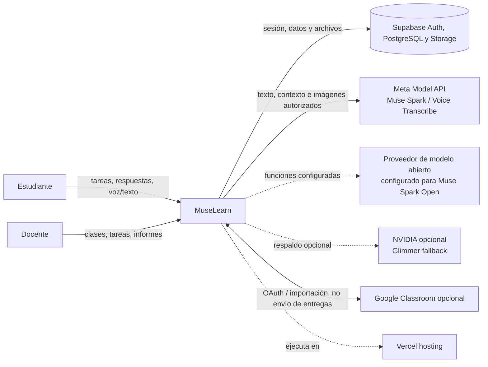
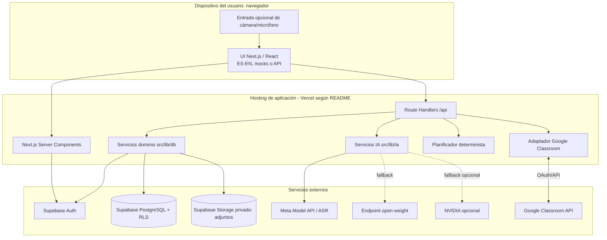
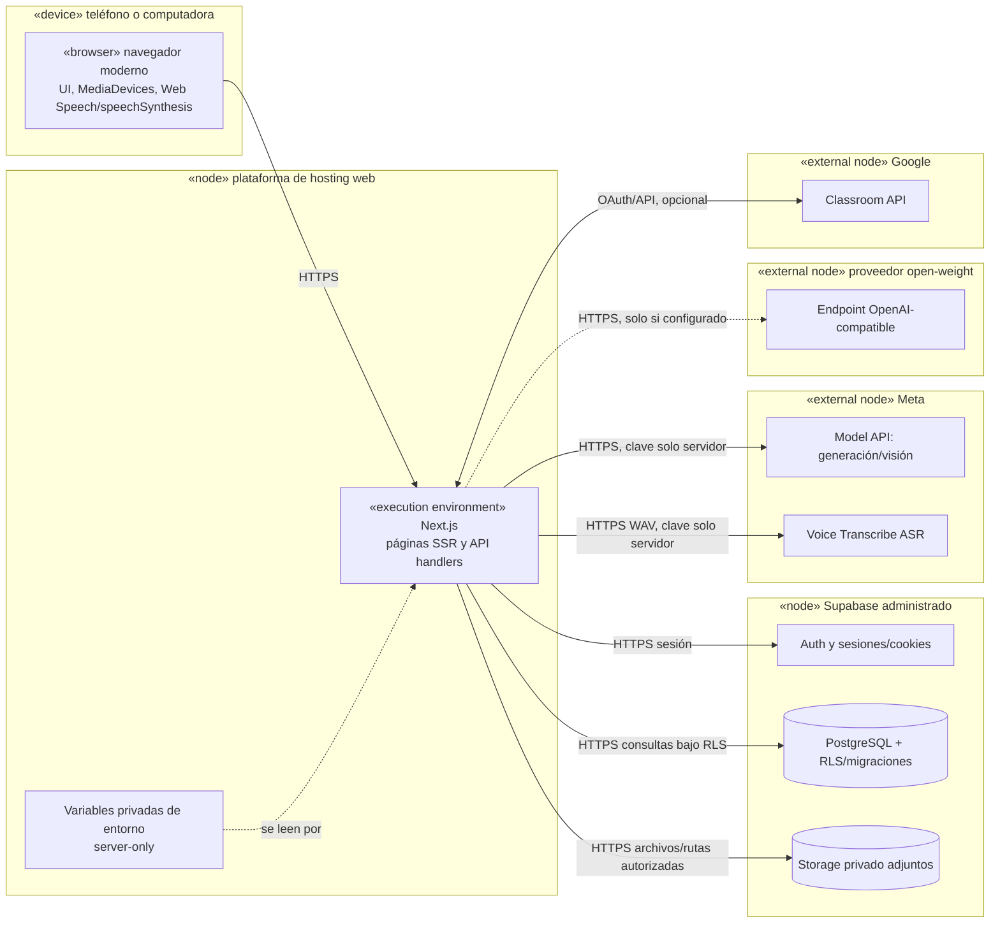
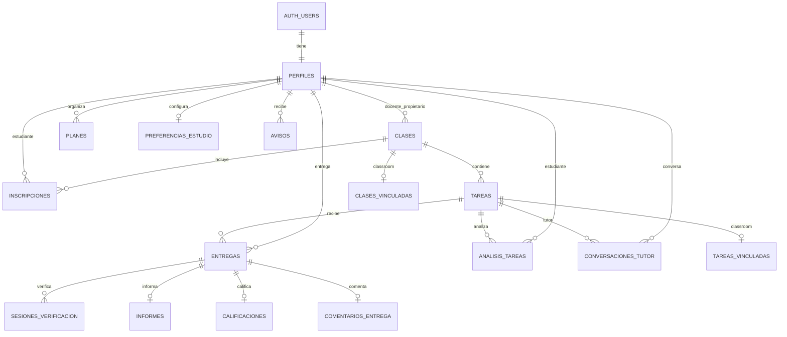
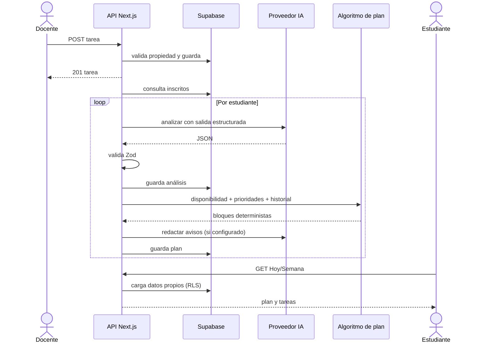
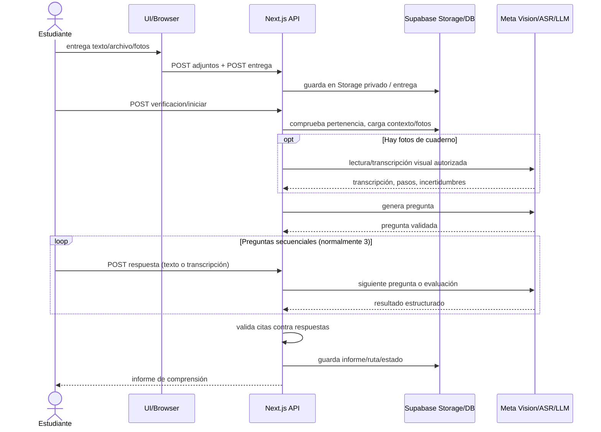

# 6. Diagramas de arquitectura y nodos

Los diagramas son una vista documental de los componentes encontrados; no constituyen infraestructura como código. Los proveedores externos son dependencias. La instalación real debe verificarse en sus paneles.

## 6.1 Contexto (C4 nivel 1)

## 6.2 Contenedores y confianza (C4 nivel 2)

## 6.3 Diagrama de nodos/despliegue (C4 nivel 3)

## 6.4 Modelo entidad-relación resumido

El detalle de campos, cardinalidades y columnas JSON está en `07-modelo-de-datos.md` y en `supabase/migrations/`.

## 6.5 Secuencia de tarea → plan

## 6.6 Secuencia de entrega → verificación

## Supuestos que requieren confirmar

La región de cada servicio, red, certificados, backups, escalado y configuración concreta de Vercel/Supabase no se deducen solo del repositorio. Google Classroom es opcional. El servicio `audios` aparece en migraciones iniciales, pero el handler actual procesa voz sin guardarla.
